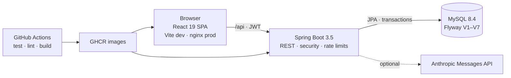

# CIICC Banking

[](https://github.com/Mina-Jen/banking-application/actions/workflows/ci.yml)
[](https://openjdk.org/projects/jdk/17/)
[](https://spring.io/projects/spring-boot)
[](https://react.dev/)
[](https://www.mysql.com/)

**A full-stack banking application where customers move money under strict
transactional rules, and administrators run the operation without ever touching
a balance.**

Customers open accounts, deposit, withdraw, and transfer; every movement is
confirmed, idempotent, and audited. Operators get a read-only portal with live
ledger reconciliation and an anomaly review queue. Built with Spring Boot,
React, MySQL, and Docker, and tested at every layer.


| Operator overview | Anomaly review |
| --- | --- |
| [](docs/screenshots/admin-overview.png) | [](docs/screenshots/admin-review.png) |
| Balances, ledger check, and read-only account access | Rule-raised flags with one-way review decisions |

<details>
<summary>Customer account view: transaction history and money forms</summary>


</details>

## Highlights

- **Customer portal** — open an account, deposit, withdraw, and transfer with an
  explicit confirmation step, plus grouped transaction history.
- **Operator portal** — system KPIs, live ledger reconciliation, account lookup,
  and an anomaly queue for unusual amounts and rapid outbound movement.
  Administrators are read-only by rule, not by convention: the API refuses any
  admin money movement with 403 and records it in the audit log.
- **Money that stays consistent** — `BigDecimal` in Java and decimal strings in
  JSON (never floating point), one transaction per movement, row locks taken in
  account-number order, and an idempotency key on every deposit, withdrawal, and
  transfer.
- **Security** — JWT access and refresh tokens with single-flight refresh and
  replay, brute-force login protection, per-user API rate limits, BCrypt, an
  audit trail, and a bootstrapped admin account.
- **AI, optional** — transaction category suggestions and a read-only account
  assistant backed by Claude. Without an API key the app still runs; those
  endpoints answer 503.
- **Tested at every layer** — 318 backend tests (H2 and Testcontainers MySQL),
  325 frontend tests, Playwright end-to-end flows, and Checkstyle + ESLint gates
  in CI.

## Architecture



The frontend never talks to the database; nginx and the Vite dev server both
proxy `/api` to the backend, so the browser stays on one origin and the JWT never
crosses hosts. Flyway owns the schema, including the unique index that makes
idempotency safe under concurrent retries.

## Run it locally

```bash
cp .env.example .env
# set MYSQL_ROOT_PASSWORD, BANKING_DB_PASSWORD and JWT_SECRET
# (openssl rand -base64 48); set ADMIN_PASSWORD to seed the first admin
docker compose up --build
```

| URL | Service |
| --- | --- |
| <http://localhost:3000> | the React app, served by nginx |
| <http://localhost:18080/swagger-ui.html> | the OpenAPI browser |
| <http://localhost:18080/actuator/health> | the backend health probe |

The backend and frontend can also run separately for development; see
[Backend configuration and run](#configuration-and-run) and
[Frontend run](#run).

## Engineering decisions worth a look

- **Deadlock-safe money movement.** Every balance change runs in one transaction,
  locks the accounts with `SELECT … FOR UPDATE` in account-number order, and is
  covered by tests for transfer ordering and rollback.
- **Retries cannot double-pay.** Each money request carries an
  `Idempotency-Key`; the same key replays the recorded response instead of
  moving money twice. [Details](#idempotency-key)
- **Read-only by rule.** The service layer, not the UI, refuses an
  administrator's deposit, withdrawal, or transfer — and audits the attempt.
  This is proven at the service, API, and component layers.
- **The client mirrors server validation.** Zod schemas on every form, with the
  same rules enforced again by the API; errors are shown next to the field and
  keep the user's input. [Details](#design-notes)
- **Failure is a feature.** Unknown account and "not yours" return the same
  answer, login and per-user calls are rate limited, and the API exposes a
  single error shape. [Details](#errors) · [Rate limiting](#rate-limiting)
- **The ledger is checked, not assumed.** Reconciliation compares stored balances
  with the sum of ledger rows and reports discrepancies to the operator.
  [Details](#reconciliation-money-integrity)

## Background

Started as the console banking exercise for TESDA's Java Programming NC III
(Phase 0), then rebuilt phase by phase: a Spring Boot API, JWT authentication and
roles, a React single-page frontend, operational features (categories, anomaly
flags, reconciliation, assistant), and finally a containerised stack with CI.
The console app, API, and SPA all live in this repository.

---

## Reference

Schema, API, configuration, tests, and operations. Jump to
[Project structure](#project-structure) or the [REST API](#rest-api).

## Technologies

- **Backend** — Java 17, Spring Boot 3.5, Spring Data JPA, Flyway, Spring
  Security 6 with JWT (jjwt) and BCrypt, springdoc-openapi, Actuator,
  Testcontainers, MySQL / MariaDB (XAMPP locally).
- **Frontend** — React 19, TypeScript 5.9, Vite 8, Tailwind CSS 4, React Hook
  Form + Zod, openapi-typescript + openapi-fetch, Vitest + Testing Library,
  Playwright.
- **Ops** — Docker / docker compose, nginx, GitHub Actions, Checkstyle, ESLint.
- **AI** — Anthropic Messages API (Claude) for category suggestions and the
  read-only assistant.
- **Console app (Phase 0)** — JDBC, JUnit 5, H2 for tests.

## Project structure

```
banking-application/
├── pom.xml                      Console app build (Phase 0)
├── docker-compose.yml           MySQL + backend + frontend in one command
├── .env.example                 Template for secrets; copy to .env (git-ignored)
├── .github/workflows/ci.yml     Test, lint, image build, GHCR publish
├── backend/                     Spring Boot 3 API
│   ├── Dockerfile               Multi-stage: Maven build -> JRE 17, non-root
│   ├── checkstyle.xml
│   └── src/
│       ├── main/java/com/tesda/ciicc/banking/backend/
│       │   ├── ai/ auth/ model/ repository/ service/ exception/ web/
│       │   └── BankingBackendApplication.java
│       ├── main/resources/db/migration/   Flyway V1–V7
│       └── test/                          Unit, MockMvc, integration, MySQL,
│                                          migration and golden-eval tests
├── frontend/                    React + TypeScript SPA
│   ├── Dockerfile               Multi-stage: Vite build -> nginx
│   ├── nginx.conf               SPA fallback, static caching, /api proxy
│   ├── openapi.json             Exported spec — source of truth for codegen
│   ├── e2e/                     Playwright specs
│   └── src/                     api/ auth/ components/ forms/ lib/ pages/ test/
├── database/                    Frozen Phase 0 bootstrap SQL
└── src/                         Console app: Main, service, dao, model, exception
```

## Backend

### Money rules

- Every balance change runs in one transaction with
  `@Transactional(rollbackFor = Exception.class)`, because the domain exceptions
  are checked and Spring would otherwise commit on them.
- Deposit, withdraw, and transfer lock rows with `PESSIMISTIC_WRITE`
  (`SELECT … FOR UPDATE`). A transfer locks both rows in account-number order,
  which prevents opposite transfers from deadlocking.
- The source balance is checked before a missing destination is announced, so
  a transfer larger than the balance answers the same `422` whether or not the
  destination exists.
- A transfer is written as `TRANSFER_OUT` on the source and `TRANSFER_IN` on the
  destination. Same-account detection compares persisted IDs, so spellings that
  differ only in case are rejected as the same MySQL row.
- Amounts stay `BigDecimal` end to end; fractions of a centavo and values that
  would not fit `DECIMAL(15,2)` are rejected.

### Migrations

Flyway owns the schema and runs at startup from
`backend/src/main/resources/db/migration`:

- `V1__init` — `accounts` and `transactions` with split transfer types.
- `V2__idempotency_keys` — stored responses replayed for repeated keys.
- `V3__auth_users` — `users` plus the `account_owners` link.
- `V4__audit_log` — append-only audit trail.
- `V5__transaction_category` — nullable `transactions.category`.
- `V6__anomaly_flags` — review queue, one flag per transaction and rule.
- `V7__transaction_description` — optional customer note on a movement.

A database created by the Phase 0 console app is baselined at `V1` instead of
re-running `CREATE TABLE`. New changes go in `V8__...sql`; `database/banking_db.sql`
is frozen.

### REST API

All endpoints live under `/api` and speak JSON. Money is always a **string**
with two decimals (`"amount": "2000.00"`), never a JSON number. Swagger UI at
<http://localhost:8080/swagger-ui.html> documents every endpoint.

| Method | Path | Purpose |
| --- | --- | --- |
| POST | `/api/auth/register` | Create a CUSTOMER login; `201`. Public |
| POST | `/api/auth/login` | Exchange username + password for a token pair. Public |
| POST | `/api/auth/refresh` | Exchange a refresh token for a new pair. Public |
| POST | `/api/accounts` | Open an account; the **bank** assigns the number. `201` with `Location` |
| POST | `/api/accounts/with-number` | `ADMIN` only: open an account with an operator-chosen number |
| GET | `/api/accounts?page=0&size=20` | Caller's own accounts for a CUSTOMER, every account for an ADMIN |
| GET | `/api/accounts/{accountNumber}` | Balance inquiry |
| POST | `/api/accounts/{accountNumber}/deposits` | Deposit (requires `Idempotency-Key`) |
| POST | `/api/accounts/{accountNumber}/withdrawals` | Withdraw (requires `Idempotency-Key`) |
| POST | `/api/transfers` | Transfer (requires `Idempotency-Key`) |
| GET | `/api/accounts/{accountNumber}/transactions?page=0&size=20` | History, oldest first |
| POST | `/api/accounts/{accountNumber}/transactions/{transactionId}/category-suggestion` | Ask Claude for a category (not saved) |
| PUT | `/api/accounts/{accountNumber}/transactions/{transactionId}/category` | Accept/store a category |
| GET | `/api/anomaly-flags?status=OPEN&page=0&size=20` | `ADMIN` only: review queue, newest first |
| PUT | `/api/anomaly-flags/{flagId}` | `ADMIN` only: close a flag as `REVIEWED` or `DISMISSED` |
| GET | `/api/reconciliation` | `ADMIN` only: stored balances vs. ledger sums |
| POST | `/api/assistant/chat` | Ask Claude about the caller's own accounts |

Everything except the three `/api/auth/*` endpoints, the API docs, and Actuator
requires `Authorization: Bearer <access token>`. A customer may only read and
move money on accounts they own; an `ADMIN` may read any account but never move
money. Ownership is enforced in `BankingService`, so it applies to every caller,
not only HTTP requests. The check runs *before* any row is looked up or locked,
and a foreign account answers with the same `404` as one that does not exist, so
the API cannot be used to discover real account numbers. `GET /api/accounts` is
scoped through `account_owners` for the same reason.

**Account numbers are assigned by the bank.** `POST /api/accounts` takes a name
and an opening deposit; an extra `accountNumber` in the body is ignored, so the
API can never confirm or deny a number the customer chose.
`AccountNumberGenerator` draws 10 digits from a `SecureRandom` (never a leading
zero), appends a Luhn check digit, and retries up to five times if the candidate
is taken. A collision — or losing the race to a concurrent insert — answers `503`
with a retry message, never the `409` that would reveal the number exists.
`ADMIN` keeps the explicit-number behaviour on `/with-number`, because an
operator keys in accounts opened on paper.

Request bodies: `{"accountName": "Juan Dela Cruz", "initialDeposit": "5000.00"}`
to open an account; `{"amount": "2000.00", "description": "SM supermarket"}` for
deposit and withdraw; `{"sourceAccountNumber": "100001",
"destinationAccountNumber": "100002", "amount": "2000.00", "description":
"Rent"}` to transfer. `description` is optional, at most 255 characters after
trimming, and blank is stored as absent.

### Errors

Every handled error uses one body shape:
`{"status": 422, "error": "Unprocessable Entity", "message": "..."}`.

- `400` — malformed request (missing header, unreadable JSON, non-numeric page or id).
- `401` — missing, expired, or invalid token, or a rejected login. An unknown
  username, a wrong password, and an over-long username all return the same body.
- `403` — valid token, wrong role: admin-only routes, a disabled account, or a
  customer calling `/with-number` or the anomaly endpoints. Never used for
  "this account is not yours".
- `404` — an account that does not exist **or belongs to someone else** (the body
  is identical; only an `ADMIN` sees the number), an unknown transaction id, or an
  unknown flag id.
- `409` — idempotency-key conflict, a duplicate number on `/with-number`, or a
  second review of an already-closed flag.
- `422` — a rejected business rule: invalid amount, insufficient funds,
  same-account transfer, bad page/size/status, `OPEN` as a review target, or an
  empty/over-long assistant message.
- `429` — too many failed logins or over the per-user API budget, with `Retry-After`.
- `503` — no account number could be assigned after five attempts, or the AI is
  unavailable (no key, upstream failure, or a reply outside the allowed vocabulary).
- `500` — anything unexpected. The cause is logged server-side and never sent;
  Spring's own `405`/`415` keep their status.

### Idempotency-Key

Deposit, withdraw, and transfer require an `Idempotency-Key` header (1–100
characters). The first request claims the key and stores the JSON response in
`idempotency_keys` **in the same transaction as the money movement**:

- The same key and body replays the stored response without moving money again.
- The same key with a different body or account is a `409`.
- A failed operation rolls the claim back, so the key stays usable for a retry.
- Concurrent requests with the same key block on the unique index; the losers
  replay the winner's response.

### Rate limiting

Two in-memory limits, both answering `429` with `Retry-After` and the usual
error body:

- **Login** — after 5 failed attempts for one username + IP in 15 minutes,
  further attempts are refused even with the right password; a success clears it.
- **API** — 60 requests per minute per signed-in user across `/api/accounts/**`,
  `/api/transfers`, `/api/anomaly-flags/**`, and `/api/assistant/**`, reads and
  writes sharing the budget. It is keyed by user id, so a token refresh does not
  reset it. `/api/auth/**` is exempt, so a throttled client can renew its session.

Counters reset on restart, which is enough for one instance; the clock is an
injected bean so tests move the window instead of sleeping.

### Pagination

List endpoints take `page` (zero-based) and `size` (1–100, default 20) and
answer with `page`, `size`, `totalElements`, and `totalPages`. A larger `size`
is a `422`.

### Transaction categories

`transactions.category` starts empty; the bank never guesses at write time. The
owner asks for a suggestion (`POST .../category-suggestion`, optionally with a
description), then accepts it (`PUT .../category`, which stores it and writes a
`CATEGORY_SET` audit entry). The vocabulary is closed in `TransactionCategory`:
`GROCERIES`, `DINING`, `TRANSPORT`, `UTILITIES`, `RENT`, `SHOPPING`, `HEALTH`,
`ENTERTAINMENT`, `EDUCATION`, `SALARY`, `TRANSFER`, `FEES`, `OTHER`.

Suggestions use the Anthropic Messages API via `ANTHROPIC_API_KEY` (never a
file); only the transaction type, amount, and optional description are sent —
account numbers, references, balances, and customer data stay in the bank. The
reply is untrusted and must match the vocabulary, else `503`. Without a key the
backend still starts and only these calls fail. Tests mock the client.

### Anomaly flags

Two rules watch money **leaving** an account — `WITHDRAW` and `TRANSFER_OUT`;
deposits and incoming transfers are never flagged. They run after the movement
is recorded, inside the same transaction, and **never block, reverse, or delay
it**; a rule failure is logged and swallowed. Customers are not told.

- **`UNUSUAL_AMOUNT`** — needs at least 3 prior outbound transactions; flags an
  amount at least 3× the average of the last 30 prior outbound transactions
  **and** at least `1000.00`.
- **`VELOCITY`** — more than 5 outbound transactions in 10 minutes; the sixth
  raises the flag.

Each flag stores a snapshot and a `details` sentence, with a unique key allowing
one flag per transaction and rule. `ADMIN` lists flags by status and closes one
as `REVIEWED` or `DISMISSED`; the decision is one-way (`409` on repeat, `422` for
`OPEN`) and writes an `ANOMALY_REVIEWED` audit entry.

### Reconciliation (money integrity)

The core invariant: an account's stored balance must equal its ledger rows —
`DEPOSIT` and `TRANSFER_IN` add, `WITHDRAW` and `TRANSFER_OUT` subtract.
`GET /api/reconciliation` checks every account in three grouped queries (credits,
debits, stored balances), reports a signed `difference` (ledger minus stored),
and lists the first 100 mismatches while only counting the rest. It **never
corrects a balance** — overwriting the wrong number would hide the bug that
produced it.

### Assistant

`POST /api/assistant/chat` runs a tool-calling conversation with Claude and
answers from the caller's own data. The model may call four tools:

- `get_balance` — optional account number; a customer omitting it gets all their
  accounts, an admin must name one.
- `search_transactions` — type, category (including `UNCATEGORIZED`), date range,
  amount range, limit 1–50.
- `summarize_spending` — outbound totals grouped by category.
- `propose_transfer` — validates and returns `PROPOSED`, never executes; the
  customer confirms with a real `POST /api/transfers`.

**Identity comes only from the verified JWT.** No user id appears in the system
prompt or any tool schema, and an invented argument such as `userId` is dropped
before the tool runs. Transaction descriptions are treated as data, and the
tools scope every query to the authenticated user regardless of what the model
asks. `AssistantPromptInjectionTest` proves this with a model that obeys a
poisoned description. The assistant is read-only, stops after five tool rounds,
and answers `503` on a missing key, upstream failure, or an empty turn. Messages
are 1–2000 characters. It is evaluated against a 50-question golden set
(`assistant-golden.json`) replayed in CI with a scripted model, so no API key is
needed.

### Configuration and run

The datasource defaults match XAMPP (`jdbc:mariadb://localhost:3306/banking_db`,
user `root`, empty password) and every value is overridable by environment
variable. XAMPP runs MariaDB, so the local default uses the MariaDB driver; for a
MySQL server set `BANKING_DB_URL` to a `jdbc:mysql://...` URL.

| Variable | Purpose |
| --- | --- |
| `BANKING_DB_URL` | JDBC URL (default `jdbc:mariadb://localhost:3306/banking_db?createDatabaseIfNotExist=true`) |
| `BANKING_DB_USER` / `BANKING_DB_PASSWORD` | Database credentials (default `root` / empty) |
| `JWT_SECRET` | **Required.** Signing key, at least 32 characters (`openssl rand -base64 48`) |
| `ADMIN_PASSWORD` | **Required.** Password for the bootstrapped admin (`ADMIN_USERNAME`, default `admin`) |
| `ANTHROPIC_API_KEY` | Optional. Enables categories and the assistant; without it those calls answer `503` |
| `CLAUDE_MODEL` | Optional model override (default `claude-haiku-4-5`) |
| `CLAUDE_BASE_URL` | Optional API base URL (default `https://api.anthropic.com`) |
| `ASSISTANT_MAX_TOKENS` | Optional cap per answer (default `1024`) |

```bash
cd backend
export JWT_SECRET="$(openssl rand -base64 48)"
export ADMIN_PASSWORD='choose-a-strong-password'
./mvnw spring-boot:run          # Windows: mvnw.cmd spring-boot:run
```

The server listens on 8080; set `SERVER_PORT=18080` when 8080 is taken. Health
at `/actuator/health`, OpenAPI JSON at `/v3/api-docs`, Swagger UI at
`/swagger-ui.html`. Changing `JWT_SECRET` invalidates every issued token.

### Tests

```bash
cd backend && ./mvnw test
```

- **API contract** — `BankingApiMockMvcTest` (status mapping, DTO shapes, required
  header, pagination, error advice), plus MockMvc tests for the anomaly, category,
  and assistant endpoints.
- **Rules and security** — `BankingServiceValidationTest` (every input rule fails
  before touching a repository), `BankingServiceOwnershipTest` (ownership checked
  before any read or lock; identical errors for foreign and missing accounts;
  transfer error order), `BankingServiceAccountNumberTest` +
  `AccountNumberGeneratorTest` (Luhn, retries, `503` not `409`), `AccountTest`.
- **Glue** — `ApiRateLimiterTest` (fake clock: 60 pass, 61st refused, per-user
  budgets), `AuditServiceTest` (over-long usernames are clipped, not fatal),
  `IdempotencyServiceTest` (claim/replay/conflict).
- **Features** — category tests, `AnomalyServiceTest` (rule boundaries, outbound
  only, rule failures never reach the movement), `ReconciliationServiceTest`
  (credit/debit lists, signed difference, read-only), and the assistant suite
  including the 50-question golden eval and prompt-injection test.
- **Full stack on H2** — `AuthFlowIntegrationTest` (JWT, non-enumerating `404`s,
  transfer error order, 61st request `429`) plus category, anomaly, and
  reconciliation integration tests.
- **Real MySQL** — `BankingServiceMySQLTest` (lock order, 50-thread conservation),
  `IdempotencyReplayMySQLTest`, `DatabaseMigrationTest` (V1–V7). Annotated
  `@Testcontainers(disabledWithoutDocker = true)`, so they skip locally without
  Docker and run in CI.

CI runs the same command and uploads the Surefire reports on failure.

### XAMPP troubleshooting

If Flyway fails with `Column count of mysql.proc is wrong`, run `mysql_upgrade`
as an account that can write XAMPP's data directory, then start the backend again.

## Frontend

`frontend/` is a Vite + React + TypeScript SPA. Its API client is **generated
from the backend's OpenAPI spec**, so request and response types cannot drift
from the Java DTOs.

### Run

```bash
# Terminal 1 — backend on 18080 (8080 is often busy on a dev machine)
cd backend && SERVER_PORT=18080 ./mvnw spring-boot:run

# Terminal 2 — frontend on 5173
cd frontend && npm install && npm run dev
```

Open <http://localhost:5173>. If the backend is on 8080, use
`BACKEND_URL=http://localhost:8080 npm run dev`. The dev server proxies `/api`,
so the browser stays on one origin and the backend needs no CORS policy. A
production build must be served behind the same proxy, or `VITE_API_BASE_URL`
plus CORS must be configured.

### Generated API client

`openapi.json` is committed, so the client regenerates without a running server:

```bash
npm run sync:api     # re-export openapi.json from the backend, then regenerate
npm run generate:api # regenerate src/api/schema.d.ts from the committed spec
```

Never edit `src/api/schema.d.ts` by hand. springdoc emits no `required` list for
records without validation annotations, so `src/api/types.ts` uses a `Defined<T>`
mapped type for fields that are always present.

### Design notes

- **Money never becomes a JavaScript number.** Amounts stay decimal strings from
  input to JSON body. `src/lib/money.ts` adds them with string column arithmetic
  because a `DECIMAL(15,2)` balance can exceed `Number.MAX_SAFE_INTEGER`; inputs
  are `type="text"` with `inputMode="decimal"`, not `type="number"`.
- **Validation mirrors the backend.** `src/lib/validation.ts` repeats the server
  rules so obvious mistakes fail before a round trip — a convenience, not a
  security control. Zod schemas in `src/forms/schemas.ts` wrap those rules rather
  than duplicating them, including per-account balance limits.
- **Moving money needs a second click.** Deposit, withdraw, and transfer open an
  accessible dialog (`ConfirmDialog.tsx`) that repeats amount, accounts, and
  balance. Focus moves to *Cancel*, `Tab` stays inside, `Escape` closes, and focus
  returns to the trigger. Opening an account has no dialog on purpose.
- **One idempotency key per intent.** `useIdempotencyKey.ts` acquires the key when
  the dialog is accepted, keeps it across a failed attempt, and releases it on
  success or when a field is edited — a retry replays, a changed amount is a new
  payment.
- **A 401 triggers one refresh, then a replay.** The refresh is single-flight, so
  parallel calls share it, and the replay reuses the same key and body.
- **The route guard is UX, not security.** `RequireAuth`/`RequireAdmin` only keep a
  browser off a page it could not load; every real check is the backend's.
- **Tokens live in `localStorage`** — the documented trade-off against an
  `httpOnly` cookie, which would need CSRF protection this stateless API does not
  have. Sessions sync across tabs through the `storage` event.

### Tests

```bash
cd frontend
npm test          # Vitest: units + component/page tests
npm run typecheck
npm run lint
npm run build     # typecheck + production bundle in dist/
```

Vitest + Testing Library cover money arithmetic (string sums stay exact),
validation, Zod schemas, JWT decoding, token storage and cross-tab sync, the auth
context, route guards, the idempotency hook, and the API client (one refresh per
401 then replay, backend messages preserved). Component tests cover the
confirmation dialog (focus, `Escape`, focus trap, busy state) and the money
forms (invalid input never calls the API; confirming calls once with a
normalized amount and one key; a retry reuses it, editing releases it). Page
tests cover loading, error, empty, and paged states for the dashboard, account,
admin overview, and review queue.

### End-to-end tests

```bash
cd frontend
npx playwright install chromium   # once
npm run e2e
```

Five browser tests run against a real backend and database:

- `register-and-deposit` — register, open an account (number assigned by the
  bank), deposit ₱1,250.75 through the dialog.
- `transfer-between-users` — two browser contexts, one transfer, both dashboards
  re-read their own balance.
- `unauthorized` — signed-out deep link redirects; a foreign account answers the
  same `Account not found.` as a number nobody opened.
- `bad-login` — a 60-character username still returns `401` with the standard
  body (the audit-overflow regression).
- `rate-limit` — 60 calls pass, the 61st is `429` with `Retry-After`, and a second
  customer is unaffected.

`playwright.config.ts` starts its own backend on **18081** against the separate
`banking_e2e` schema and a Vite server on **5273**, so it never touches
`banking_db` or the 18080 server. Tests run sequentially and register fresh
users. Playwright is not in CI yet; it needs a database service container.

## Docker, CI and deploy

### Whole stack

```bash
cp .env.example .env        # set MYSQL_ROOT_PASSWORD, BANKING_DB_PASSWORD,
                            # JWT_SECRET, and ADMIN_PASSWORD
docker compose up --build
```

`.env` is git-ignored; only `.env.example` is committed. Compose refuses to
start without its three secrets (`${VAR:?message}`), and the backend refuses a
`JWT_SECRET` shorter than 32 characters.

| URL | What answers there |
| --- | --- |
| <http://localhost:3000> | the React app, served by nginx |
| <http://localhost:18080/api/...> | the Spring Boot API |
| <http://localhost:18080/swagger-ui.html> | the OpenAPI browser |
| <http://localhost:18080/actuator/health> | the health probe |
| `localhost:33060` | MySQL, for a database client |

`docker compose logs -f backend`, `docker compose ps`, `docker compose down`
(keep data), `docker compose down -v` (delete the volume).

`db` is `mysql:8.4` with a named volume and a `mysqladmin ping` healthcheck; the
backend starts only once it is healthy, so Flyway never races an empty data
directory. Container port 8080 is published as 18080, and 33060 avoids XAMPP's
3306. The JDBC URL carries `useSSL=false&allowPublicKeyRetrieval=true`, without
which MySQL 8's `caching_sha2_password` fails at startup.

`frontend/nginx.conf` proxies `/api/` to `http://backend:8080`, so the browser
never crosses origins and the JWT never leaves the host. It serves `index.html`
for unknown paths (React Router), caches `/assets/` for a year, and marks
`index.html` `no-cache` so a deploy is visible immediately.

### Images

Both are two-stage builds: toolchain in the build stage, only a JRE or nginx in
the runtime. The backend runs as a non-root user. Tests are skipped during the
image build on purpose — CI runs them separately, and Testcontainers needs a
Docker daemon that does not exist inside a build. Both use BuildKit cache mounts.

### Lint

```bash
cd backend  && ./mvnw -B checkstyle:check
cd frontend && npm run lint
```

Checkstyle flags imports, brace-less statements, `==` on strings, `equals`
without `hashCode`, and naming; ESLint adds React hook dependency checks, dead
code, accidental globals, and `any`. Formatting is deliberately out of scope.

### GitHub Actions

`.github/workflows/ci.yml` runs on every push to `main`, every pull request, and
on demand. The image job is gated behind the other three:

| Job | What it proves |
| --- | --- |
| `backend` | `./mvnw -B test` — the full suite, including Testcontainers MySQL and the assistant golden eval |
| `frontend` | `npm ci`, `npm run build`, `npm test` |
| `lint` | Checkstyle and ESLint |
| `docker` | both images build; on `main` they are pushed to GHCR |

The GitHub runner has a Docker daemon, so the MySQL tests that skip on a laptop
execute there. Playwright is **not** in CI because it needs a database service
container.

### Publish (GHCR)

On a push to `main`, the `docker` job pushes `banking-backend` and
`banking-frontend` to `ghcr.io/<owner>/<repo>/` with `latest` and `sha-<short>`
tags. Pull requests build but never push. The first push creates the package as
private, so pull with `docker login ghcr.io`. Because compose takes image names
from variables, the same file runs from source or from the registry:

```bash
export BACKEND_IMAGE=ghcr.io/<owner>/<repo>/banking-backend:latest
export FRONTEND_IMAGE=ghcr.io/<owner>/<repo>/banking-frontend:latest
docker compose pull && docker compose up --no-build
```

There is no server or SSH target, so publishing the image is the end of the
pipeline; adding a host means one job running `docker compose up -d` over SSH
with secrets stored in Actions.

### Defects the real MySQL run exposed

Both were invisible to H2 and MariaDB, which is the argument for running the
stack rather than only unit tests:

1. **500 on every idempotent retry** — `IdempotencyService.replay` was
   `@Transactional(readOnly = true)`, but its lookup is a locking read, which
   MySQL rejects (`ERROR 1792`). `IdempotencyReplayMySQLTest` is the regression.
2. **Foreign-key violations in test cleanup** — `BankingServiceMySQLTest` deleted
   tables in dependency order instead of reverse order; cleanup now runs strict
   reverse-dependency order.

## Console application (Phase 0)

The original JDBC console app remains in `src/`.

1. Start MySQL in XAMPP and run `database/banking_db.sql` in phpMyAdmin.
2. Settings default to XAMPP values; override with `BANKING_DB_URL`,
   `BANKING_DB_USER`, and `BANKING_DB_PASSWORD` rather than editing
   `DatabaseConnection.java`.
3. Run with `mvn compile exec:java`, or open `pom.xml` in IntelliJ and run `Main`.

`mvn test` runs the console suite without MySQL: model and validation rules,
service/DAO integration on H2, and a 50-thread concurrency test that checks money
is conserved and no balance goes negative. H2 locking differs from MySQL, so the
concurrency test is not a substitute for checking row locks on the real server.

The demonstration script creates `100001`/`100002` with `5000`/`8500`, deposits
`2000`, withdraws `1500`, transfers `2000` (balances `3500`/`10500`), shows
history on both accounts, and proves the duplicate-account, insufficient-funds,
and centavo-precision errors.

## Author

- Name: Jen Otehlie Mina
- Qualification: Java Programming NCIII
- Batch: 13
- Training Center: Center for International Industries Competence Corp. (CIICC)
- Trainer: Mr. Michael Ampo
